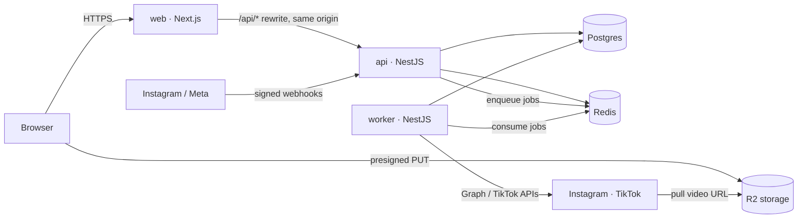

# Reply22

Instagram comment → DM automations, plus one-upload publishing to Instagram and TikTok.
Built only on the official Meta and TikTok APIs.

> This repository is the public record of **how Reply22 is built**: the architecture guide, security
> controls, the architecture decision record and the production runbook. The application source is
> private. I'm happy to walk through the code on a call: [LinkedIn](https://www.linkedin.com/in/nadav-magen-182311323/) · [email](mailto:magennadav32@gmail.com).

Designed, built and operated solo by [Nadav Magen](https://github.com/NadavM-ux) in 2026.

## What it does

- **Comment → DM.** A creator chooses a post and keywords. When someone comments, Reply22 posts the public
  reply and sends the private message (a link, a file, a code) within seconds, inside Meta's messaging rules:
  one private reply per comment, per-account DM budgets, and retries that never double-send.
- **Publish once, everywhere.** Upload a video once in the browser, pick Instagram and/or TikTok, publish now or
  schedule up to 60 days ahead, and watch each target move from *uploading* to *published* (or to a readable error).
- **Accounts people can trust.** Email or Google sign-in, TOTP two-factor, team workspaces, listable sessions,
  user data export and deletion, Meta deauthorize and data-deletion callbacks, and daily data-retention purges.

## How it runs

- **web** renders pages and calls the API from the server. The browser only reaches the API through a same-origin
  `/api/*` rewrite, so cookies stay first-party and CORS stays closed.
- **api** owns HTTP: auth, validation, webhooks. It never calls Instagram or TikTok on a request path; anything slow
  or rate-limited becomes a queue job.
- **worker** does the slow work: automation runs, publishing, token refresh, retention.
- **Postgres** holds the truth. **Redis** holds sessions, rate-limit counters and queues. Both app tiers are stateless.

| Layer | Choice |
| --- | --- |
| Language | TypeScript end to end, pnpm + Turborepo monorepo (3 apps, 6 shared packages, ~21k lines) |
| Web | Next.js 16, React 19, shadcn/ui, Motion |
| API & worker | NestJS 11, Zod contracts shared with the web app, Better Auth |
| Data | PostgreSQL 17 with Drizzle ORM, UUIDv7 keys; Redis 7 with BullMQ |
| Storage | Cloudflare R2 through the AWS S3 SDK, presigned uploads straight from the browser |
| Delivery | One distroless `Dockerfile` → three images (280–340 MB, non-root, no shell); GitHub Actions runs lint, typecheck, 112 tests against real Postgres and Redis, build, `pnpm audit`, and the image builds |
| Hosting | Railway (web, api, worker, Postgres, Redis) behind Cloudflare DNS |

## Decisions worth reading

- **Webhooks only acknowledge.** Verify the `X-Hub-Signature-256` HMAC over the raw body, insert into a
  `webhook_events` table with a unique key (so Meta's retries dedupe), enqueue, return `200`. Every Graph API call
  happens in the worker. → [ADR 0001](docs/adr/0001-architecture.md)
- **Exactly-once effects.** `automation_runs (automation_id, trigger_ref)` is unique and publishing jobs use
  deterministic IDs, so a retried event or a re-queued job can never send a second DM or fork a second upload chain.
  → [Architecture guide](docs/ARCHITECTURE.md#request-lifecycles)
- **Rate limits delay, they don't fail.** A Redis token bucket per account; a job that hits the ceiling is rescheduled.
- **Secrets at rest.** Platform tokens are AES-256-GCM encrypted under a versioned keyring, so a key rotates by
  prepending a new one with no downtime. → [Security](SECURITY.md)
- **Clean architecture that the linter enforces.** `domain` imports no framework; `application` may not import
  `presentation`; every repository method that reads tenant data takes a `workspaceId`.
  → [Layers and the dependency rule](docs/ARCHITECTURE.md#layers-and-the-dependency-rule)
- **Honest trade-offs.** Row-Level Security, table partitioning and a transactional outbox are deferred, and
  written down as such. → [Known trade-offs](SECURITY.md#known-trade-offs)

AI coding assistants were part of the workflow from the first commit. Their output was treated as untrusted:
every change had to pass the shared Zod contracts, the lint rules above and the test suite before it merged.

## Documents

| Read | For |
| --- | --- |
| [docs/ARCHITECTURE.md](docs/ARCHITECTURE.md) | How the code is organised, the three request lifecycles, conventions, how a feature is added |
| [SECURITY.md](SECURITY.md) | Every security control and where it lives, the production checklist, known trade-offs |
| [docs/adr/0001-architecture.md](docs/adr/0001-architecture.md) | The key decisions and what was deliberately deferred |
| [docs/railway.md](docs/railway.md) | The production runbook: services, variables, DNS, outside services, first-deploy checklist, release rules |
