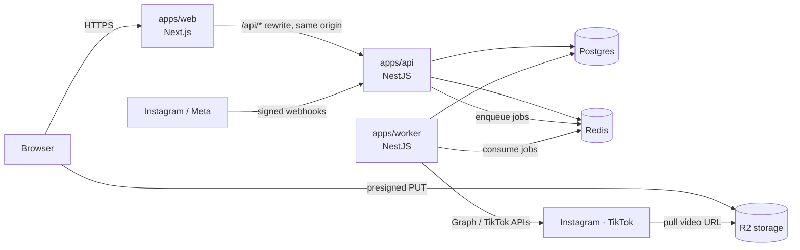

# Architecture guide

How the code is organised, why, and how to add to it without breaking the rules CI enforces.

## The system



- **web** renders pages and calls the API from the server (cookies forwarded). The browser only talks to the API
  through the same-origin `/api/*` rewrite, so cookies are first-party and CORS stays closed.
- **api** owns HTTP: auth, validation, webhooks. It never calls Instagram or TikTok on a request path; slow or
  rate-limited work becomes a queue job.
- **worker** does the slow work: automation runs, publishing, token refresh, data retention.
- **Deployment:** web, api and worker are three targets of one `Dockerfile`, each scaled independently (see [railway.md](railway.md)).
- **Postgres** holds the truth. **Redis** holds sessions, rate-limit counters and queues. Both app tiers are
  stateless, so you can run any number of instances.

## Layers and the dependency rule

```
packages/domain        entities, value objects, ports (interfaces)     ← depends on nothing
packages/contracts     Zod request schemas, queue payloads, product name
packages/db            Drizzle schema + repositories (implement domain ports)
packages/integrations  Instagram, TikTok, S3/R2, email clients (adapters)
packages/security      token encryption, HMAC, signed OAuth state
packages/nest-infra    Nest wiring shared by api and worker
apps/*/modules/<feature>/
  application/         use cases: orchestrate domain + ports, no HTTP
  infrastructure/      adapters specific to this app (queues, OAuth providers)
  presentation/        controllers / queue processors: translate I/O, nothing else
```

Arrows only point inwards. ESLint enforces the key ones: `domain` may not import frameworks or other packages;
`application` may not import `presentation` or Express.

## Request lifecycles

**Comment → DM**
1. `POST /api/webhooks/meta` → `MetaWebhookController` → `IngestMetaWebhookUseCase`
2. Verify `X-Hub-Signature-256` over the raw body → insert into `webhook_events` (unique key, so retries dedupe) → enqueue
   `comment.received` → `200`. No Graph API calls here.
3. Worker `CommentProcessor` → `HandleCommentUseCase`: find account → first matching active automation → reserve DM budget in
   Redis → `automation_runs.tryStart` (unique per comment = exactly once) → action handlers send the reply and DM.

**Publish**
1. Browser asks `POST /api/media/uploads` for a presigned URL and uploads straight to R2, then confirms.
2. `POST /api/posts` stores one row per platform target and enqueues a delayed job per target.
3. Worker `PublishTargetUseCase` starts the platform upload, then re-queues itself to poll (deterministic job IDs, so a retry
   can't fork a second chain) until the platform reports published or failed.

**Sign-in** is Better Auth mounted at `/api/auth/*` (see `common/auth/auth.factory.ts`). Sessions live in Redis and Postgres;
`SessionGuard` resolves them for our own routes and `WorkspaceGuard` checks membership of the `x-workspace-id` workspace.

## Front end

- **shadcn/ui** components live in `apps/web/src/components/ui` (vendored source; add more with `npx shadcn@latest add <name>` from `apps/web`).
- **Theme** tokens are in `apps/web/src/app/globals.css`: cool off-white canvas, near-black ink, and one "signal" gradient reserved for comment→DM moments. Type: Bricolage Grotesque (display), Geist (UI), Geist Mono (data).
- **Motion:** above-the-fold entrances are CSS (they run before hydration); scroll reveals and interactions use Motion (`LazyMotion`, ~15 kB). Everything respects `prefers-reduced-motion`.

## Conventions

| Thing | Convention |
|---|---|
| Files | `kebab-case.<role>.ts`: `create-automation.use-case.ts`, `automations.controller.ts`, `automation.repository.ts` |
| Size | ≤ 250 lines per file, ≤ 60 lines per function (120 for React components), complexity ≤ 10, one class per file |
| Validation | Every request body goes through a Zod schema from `@app/contracts` (`ZodValidationPipe`); route params through Nest pipes |
| Business errors | Throw `DomainError(code, message)`. `DomainErrorFilter` maps codes to HTTP status; messages are shown to users, so write them for people |
| Tenancy | Every repository method that reads tenant data takes `workspaceId`. The only exceptions are worker-internal lookups, which say so in a comment |
| Ports | Domain ports are TypeScript interfaces injected by symbol (`TOKENS.*`); app-level ports are abstract classes |
| Comments | Explain *why* and anything non-obvious (security, ordering, limits). Don't narrate the code |
| Tests | Next to the code (`*.spec.ts`), with fakes for ports. Repository behaviour that depends on SQL is tested against real Postgres in `packages/db/test` |

## Adding a feature (example: "archive an automation")

1. **Domain:** add `archive()` to `Automation` with its rules and a unit test.
2. **Contracts:** if the API takes input, add a Zod schema in `packages/contracts`.
3. **Persistence:** if new data is stored, change `packages/db/src/schema/*`, run `pnpm db:generate`, review the SQL migration.
4. **Use case:** `apps/api/src/modules/automations/application/archive-automation.use-case.ts`, depending only on ports.
5. **Presentation:** a controller method with guards and the validation pipe. Register providers in the module.
6. **Web:** a server action in `apps/web/src/actions` and UI built from `components/ui` (shadcn).
7. Run `pnpm turbo run lint typecheck test build`.
